# Design

## Context

See [proposal.md](proposal.md) for motivation and [specs/decision-provider-selection/spec.md](specs/decision-provider-selection/spec.md) for observable behavior. Today `readPublicConfig()` accepts only `autoInvoke`, `resolveProviderAsync()` selects Jev from `TYPESAFE_API_KEY` or the existing `fast-context` OpenCode integration, and `runFastContext()` prompts only for TypeSafe. `DecisionProvider` already defines `score` and optional `choose`. The engine sends up to 24 filtered snippets, scores them with eight concurrent requests by default, and applies a global `minDecision: 0.15` tuned on Jev. The optional directory hint is gated by `FAST_CONTEXT_DIRECTORY_HINT=1`.

Google documents `POST https://generativelanguage.googleapis.com/v1beta/decisions` with model `gemini-decision-1`, `x-goog-api-key`, shared `input`, and named `questions`. `noul` returns a yes probability; `choice` returns a selected option and probabilities; `usage.total_input_tokens` and `usage.total_output_tokens` supply consumption. Its binary criteria use `true_description` and `false_description` rather than Jev's `true` and `false`. Sources checked 2026-11-16: [API contract](https://aistudio.google.com/docs/decisions-api), [model](https://aistudio.google.com/docs/models/gemini-decision-1), [terms](https://aistudio.google.com/docs/terms), [pricing](https://aistudio.google.com/docs/pricing#gemini-decision), [limits](https://aistudio.google.com/docs/rate-limits#gemini-decision).

## Goals / Non-Goals

**Goals:** Keep provider choice explicit and stable across a search; reuse discovery, sanitization, evidence validation, and result formatting. Isolate authentication per service. Produce a reproducible paired comparison and provider-specific abstention calibration.

**Non-Goals:** Generic Gemini text generation, automatic provider failover, implicit switching based on available keys, multimodal repository indexing, changing Jev's prompt or calibrated threshold, and promising Google's quoted latency for full searches.

## Decisions

### 1. Resolve the provider from a public enum

Use one plugin instance with a TUI provider picker. Persist the selected provider in OpenCode storage; an optional `decisionProvider` option initializes a fresh installation, but a subsequent TUI choice wins. Reject invalid values explicitly. With no selection, return setup guidance before resolving credentials or sending source. Read the authoritative stored choice for every status call and at the start of every tool invocation, then snapshot it through missing-key handling and 401/403 retry. Do not rely on a closure initialized once at plugin setup: another server instance or reload may have changed the choice. A storage read failure is an explicit setup failure, not an invitation to choose a default or send source. The result metadata extends the provider ID union with `gemini`, leaving the search tool input and result version unchanged.

Alternative considered: choose whichever key exists. This would unexpectedly change the source recipient and make results hard to reproduce.

### 2. Add a small REST adapter over the existing decision interface

Use the fixed documented Google host and `v1beta/decisions`; permit endpoint/fetch injection only as a private test seam, never via public configuration or environment endpoint overrides. A scoring request retains the existing `buildState(query, candidate)` content, serialized as a text `input`, and asks a `relevant` `noul` question with the existing relevance instructions. Translate `RELEVANCE_CRITERIA.true/false` to `true_description/false_description`. Parse `answers.relevant.noul`, accept only finite values in [0,1], and aggregate `usage.total_input_tokens` and `total_output_tokens` over requests. Validate response shape rather than treating missing answers as zero. Use request timeouts, cancellation, bounded concurrency, and partial scoring semantics already expressed by `ScoreResult`.

For optional directory choice, map directory paths to short stable option IDs within one request because Google's option labels have length and character constraints. Translate the returned ID back to a supplied directory and ignore unknown IDs. Preserve the existing environment gate and deadline check for directory hints.

Alternative considered: adding `@google/genai`. Direct REST keeps the existing fetch-based provider boundary and avoids a runtime dependency for two typed operations. The adapter follows the public REST examples and can be replaced by the SDK if contract drift warrants it.

### 3. Keep credentials and their failure handling separate

Keep the current `fast-context` OpenCode integration ID for existing TypeSafe credentials and add a distinct Gemini credential integration ID. `GEMINI_API_KEY` takes precedence over its stored Gemini key; neither provider reads the other's key. Extend the existing RPC/TUI broker with a selected-provider identifier for status, prompt copy, verification, replacement, and revoke operations. Probe a submitted Gemini key with a tiny, source-free Decisions request that proves access to `gemini-decision-1`, using a bounded timeout; avoid a model-list probe that might validate a key without granting access to this endpoint. Store only through OpenCode's credential API. A rejected environment key never deletes the corresponding stored key; a rejected stored key can be removed and reprompted in an interactive session. Source-free validation still consumes a small amount of quota.

Model selection and credential setup separately. `Unselected` or `Active(previous)` enters `Pending(target)` when the user picks a provider or runs targeted onboarding such as `/fast-context auth gemini`. Resolve an existing key or verify a new key for the target, persist the target selection last, then read status back before reporting success. If the user cancels or validation/persistence fails, retain the previous active choice and report the incomplete step. Credential storage and provider selection are different host stores, so a key saved before a selection write fails may remain available for a retry; never claim setup complete in that case. A config-supplied initial choice or revoked key can still be active without a usable credential, which is a visible missing-key state rather than a connected state.

```mermaid
stateDiagram-v2
    [*] --> Unselected
    Unselected --> Pending: Choose or target provider
    Active --> Pending: Switch provider
    Pending --> Active: Credential usable; selection persisted and read back
    Pending --> Unselected: Cancel or failure with no previous choice
    Pending --> Active: Cancel or failure retains previous choice
    Active --> Searching: Search snapshots persisted choice
    Unselected --> Fallback: Search sends no source
```

For each provider, track `absent -> verifying -> available -> rejected/revoked`; environment and stored keys remain distinct sources. `Available` only means a key resolves. A successful source-free verification or provider request supplies a time-stamped `connected` observation; an unverified stored or environment key is labeled as such, and subsequent 401/403, quota, timeout, or RPC errors change the visible observation without silently changing provider. A 429 or timeout does not falsely mark a credential invalid.

Alternative considered: reuse the TypeSafe integration row for both keys. That prevents switching back safely, obscures the recipient, and risks passing a key to the wrong host.

### 3a. Expose live provider status in the TUI

The server status RPC returns the authoritative selected provider, credential source/presence per provider, verification or last request outcome with time, and a non-secret instance identifier. The TUI renders a compact Fast Context indicator through the additive `sidebar.footer` slot: `Choose provider`, `Gemini · no key`, `Gemini · key stored, unverified`, `Gemini · connected`, or `Gemini · error (401/429/timeout)` as appropriate. A disconnected RPC is shown as `Fast Context · status unavailable`, never as connected. A small provider status event refreshes the sidebar after selection, key save/revoke, and search outcome; initial mount and reconnect fetch status. The detailed `/fast-context auth status` dialog uses the same data and points to the next action. Do not expose keys, repository excerpts, or raw error bodies in RPC status, events, or UI.

Include the server instance identifier in search diagnostics so a real-host test can detect TUI RPC and tool execution resolving to different plugin instances. If duplicate entries are loaded, surface the mismatch and avoid treating a successful key prompt as proof that the active search tool is configured. This identifier is diagnostic only; selection remains in OpenCode storage rather than a TUI-local cache.

### 4. Calibrate Gemini separately and retain safe failures

Supply an effective provider-specific `minDecision` to the engine; keep Jev at 0.15. Select Gemini's threshold from held-back development folds, record its value and prompt hash, and freeze both before running fresh tasks. Do not use `confidence` as the probability of relevance: for `noul`, Google defines confidence as `max(noul, 1 - noul)`. Treat invalid response, 400 content block, 429 quota, 5xx, and timeout as provider failures with safe status/reason and no provider switch. Continue using the current outbound redaction and repository boundary checks; do not promise they catch all confidential code.

Alternative considered: use Jev's 0.15 threshold or Google's confidence directly. Neither has demonstrated equivalent false-abstention behavior on this corpus.

### 5. Benchmark paired end-to-end retrieval, then optimize packing

First repair `bench/run.ts`: it imports a `ProviderKind` type no longer exported and calls `resolveProvider({ provider: ... })` though resolution now accepts an environment object. Make the runner select an explicit arm without changing production defaults. Run Jev and Gemini on the same pinned checkouts, queries, discovery limits, snippets, and machine; randomize order and repeat runs to separate network variation. Start with one request per candidate to preserve the current semantic boundary. Capture per-request timings, errors/429s, calls, usage, total search time, quality, and estimated cost. Compare median and p95 latency, Recall@5, top-1, false abstention, no-answer specificity, valid completion, and fallback rate. Use development tasks for prompt/threshold changes; the existing four-task validation split has already influenced the project and is not a new holdout. Freeze the variants and evaluate on untouched tasks according to `EXPERIMENT_PROTOCOL.md` before making quality or speed parity claims. Then compare a multi-question Gemini request as a distinct variant, checking for cross-candidate contamination and input-token/quota effects. Keep raw runs local and avoid logging credentials or unredacted source to public reports.

Google's reported 150–250 ms end-to-end request latency is a service claim under its tested conditions, not a measured plugin result. At 24 requests per search, the free tier's 50,000 TPM may constrain repeated searches even when its 200 RPM limit does not. The published $0.10 per million input tokens applies to paid API use; count actual response usage instead of estimating from characters.

## Risks / Trade-offs

- [Risk] Google's free-tier data-use terms permit product improvement and human review of submissions. → Disclose the difference in setup and masked prompt, link current terms, and advise paid API projects for confidential repository use. Paid use still has limited abuse-monitoring logs.
- [Risk] A new `v1beta` endpoint or response field changes. → Fix the endpoint, validate shapes, and cover request/response/error fixtures; keep version and model visible in metadata.
- [Risk] More simultaneous calls hit RPM/TPM caps. → Honor bounded concurrency and deadlines, record 429s and usage, and evaluate packing separately without raising limits blindly.
- [Risk] The existing global fetch injection seam in `systemone.ts` is mutable. → Keep the Gemini transport instance-local and test concurrent providers without cross-key or cross-host leakage.
- [Risk] Small or previously tuned task sets overstate quality. → Keep development and new untouched evaluation separate, retain failures in denominators, and report uncertainty per `EXPERIMENT_PROTOCOL.md`.

## Migration Plan

Add the Gemini credential integration without modifying existing `fast-context` stored keys. Select either provider from `/fast-context provider` and onboard its own key; switching back uses the still-stored TypeSafe credential. Remove the provider option to use TUI selection. No migration of keys or repository data is needed. Do not publish comparative performance claims until the paired benchmark meets its stated evidence standard.

Update the self-test wizard to inspect the active provider and sidebar state after onboarding, then require an actual `fast_context_search` result reporting Gemini before it declares success. In release validation, exercise the real OpenCode TUI command through RPC, persisted storage, and the tool, including restart, a cancelled switch, and another server instance. Test failures must remain visible rather than being masked by a passing handler-level suite. Begin any PR recording only after authentication; review and remove local captures after the PR attachment is verified.
