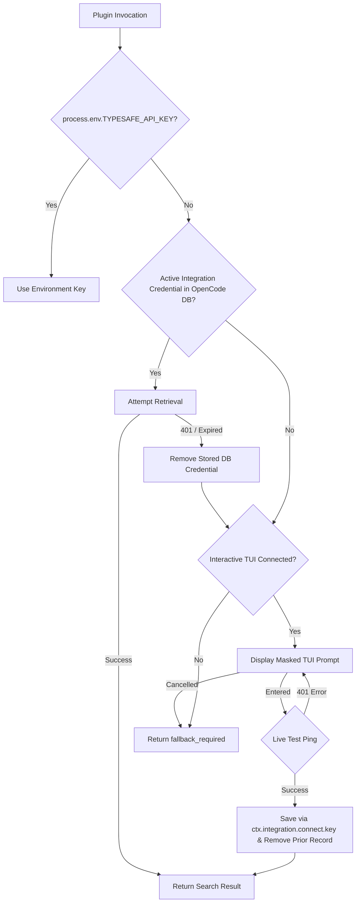

# Design

## Context

`opencode-fast-context` is an OpenCode 2 plugin. Today, `resolveProvider()` in `src/config.ts` exclusively checks `process.env.TYPESAFE_API_KEY`. When users install the plugin without a local repository clone (e.g., via `opencode plugin add`), there is no access to repository scripts like `setup:opencode`, forcing users to manually export the token in their shell profile. This breaks when OpenCode is launched via macOS Dock, system services (`opencode service restart`), or desktop launchers where shell dotfiles are not inherited.

Research against OpenCode 2.2.5 (`docs/opencode-credential-storage-research.md`) confirmed that OpenCode exposes a native integration credential store backed by its internal SQLite database (`packages/core/src/credential.ts` and `packages/core/src/database/database.ts`), used by OpenCode's own non-model plugins such as Exa websearch.

See `proposal.md` for background motivation.

## Goals / Non-Goals

**Goals:**
- Provide an interactive, masked TUI input prompt in OpenCode when the plugin lacks a credential or when a stored key is expired/invalid.
- Persist credentials exclusively through OpenCode's native integration credential store (`ctx.integration` / SQLite database) rather than managing a custom `credentials.json` file or OS Keychain bridge.
- Trigger the prompt automatically on first unauthenticated search and on expired stored-key rejection, plus via explicit `/fast-context auth` commands.
- Validate the key live against the TypeSafe endpoint before persisting to ensure immediate feedback.
- Support strict precedence: `process.env.TYPESAFE_API_KEY` > OpenCode integration credential store > interactive prompt.
- Ensure clean replacement and revocation so repeated `connect.key` calls do not accumulate stale rows in OpenCode's credential table, and environment-variable failures never delete a stored database credential.
- Protect headless execution: return immediate `fallback_required` rather than hanging on stdin when non-interactive.

**Non-Goals:**
- Custom credential files (`credentials.json`) or custom POSIX/Windows ACL management (`chmod` / `icacls`).
- OS Keychain integration (macOS Keychain, Linux Secret Service, Windows Credential Manager) or native compilation dependencies.
- Cloud synchronization or sharing of credentials between physical machines.
- Writing any credentials to repository files, workspace paths, `.env` files, or `opencode.jsonc`.

## Decisions

### Decision 1: Storage via OpenCode Integration Credential Store (`ctx.integration`)

- **Design Choice**: Register a dedicated integration ID (e.g., `fast-context` / `typesafe-jev`) with a key authentication method using `ctx.integration.transform` and `editor.method.update`, following the pattern of OpenCode's built-in Exa websearch plugin.
- **Save & Resolve Flow**:
  - Save validated tokens via `ctx.integration.connect.key({ integrationID, key })`.
  - Retrieve the active credential via `ctx.integration.connection.active(integrationID)` followed by `ctx.integration.connection.resolve(connection)`.
- **Why Integration Store over Custom File or `ctx.storage`**:
  - Eliminates bespoke file path resolution, atomic temp-file writes, and platform permission code (`0o600` on Unix vs. NTFS ACLs on Windows). OpenCode's SQLite database layer already sets `0o600` on database and sidecar files on Unix and relies on standard per-user profile ACL inheritance on Windows.
  - Compared with generic `ctx.storage` (`kv` table), `ctx.integration` uses OpenCode's first-class `credential` table and protocol handlers (`credential.list`, `credential.remove`, `credential.activate`).
  - Because the OpenCode server owns the SQLite database, both interactive TUI sessions and background service runs (`opencode service`) share the same credential store on the server host.

### Decision 2: Credential Replacement, Revocation, and Source Isolation

- **Server vs. Client API Boundary**:
  - The server plugin context (`ctx`) exposes `ctx.integration.connect.key`, `ctx.integration.connection.active`, `ctx.integration.connection.resolve`, and `ctx.credential.activate`, whereas credential listing and deletion (`credential.list`, `credential.remove`) are exposed on the client/server protocol API.
  - Repeated calls to `ctx.integration.connect.key` create additional rows in OpenCode's `credential` table. Therefore, when updating or revoking a stored key through the TUI/client bridge (or server credential handler), prior credential records for the Fast Context integration ID must be removed via `credential.remove` so only the current active record remains (or zero records after revoke).
- **Source Isolation on HTTP 401/403**:
  - If the active credential came from `process.env.TYPESAFE_API_KEY` and fails with HTTP 401/403, the plugin MUST NOT delete any stored database credential or silently override the explicit environment variable; it reports the invalid environment key.
  - If the active credential came from OpenCode's integration credential store and fails with HTTP 401/403, the plugin removes the invalid stored credential record and triggers the interactive re-authentication prompt (when in an interactive TUI session) or returns `fallback_required` (when headless).

### Decision 3: Triggering & Server-to-TUI Coordination

- **Plugin Parts & RPC**:
  - `fast_context_search` executes in the server plugin entry, while masked dialogs and slash/palette commands (`/fast-context auth`) run in the `./tui` plugin entry, communicating over OpenCode's plugin RPC bridge.
- **Automatic Triggering**:
  - **First Search**: When `fast_context_search` is called without `process.env.TYPESAFE_API_KEY` and with no active integration credential in OpenCode's database, the server requests an interactive prompt from the connected TUI part if an interactive client is attached.
  - **Expired / Invalid Stored Key**: If Jev returns HTTP 401/403 for a database-backed credential, the stored credential is removed and the TUI prompt is requested with an expired/invalid key message.
- **On-Demand Commands**: Users can run `/fast-context auth` (and status/revoke actions) from the TUI to inspect status, set/replace the key, or revoke the stored credential.

### Decision 4: Live Key Testing & Validation

- When the user enters a token in the TUI prompt, the plugin performs a lightweight HTTP verification probe to the TypeSafe endpoint with a bounded timeout before calling `ctx.integration.connect.key`.
- If the probe returns 401/403, an inline validation error is shown in the TUI and the prompt remains open for correction without persisting anything to OpenCode's database.

### Decision 5: Resolution Precedence

## Risks / Trade-offs

- **[Risk] Background service or headless run cannot prompt user** -> **Mitigation**: Detect when no interactive TUI client is connected; return immediate structured `fallback_required` directing the user to run OpenCode interactively or set `TYPESAFE_API_KEY`.
- **[Risk] Repeated `connect.key` calls create duplicate rows in OpenCode's `credential` table** -> **Mitigation**: Explicitly enumerate and remove old Fast Context integration credential records via the client/server `credential.remove` API during key replacement and revocation.
- **[Risk] Plaintext storage in SQLite database** -> **Mitigation**: Matches OpenCode's standard credential model for providers and plugins; OpenCode enforces `0o600` on the SQLite database and sidecars on Unix and relies on standard per-user profile ACL inheritance on Windows.
